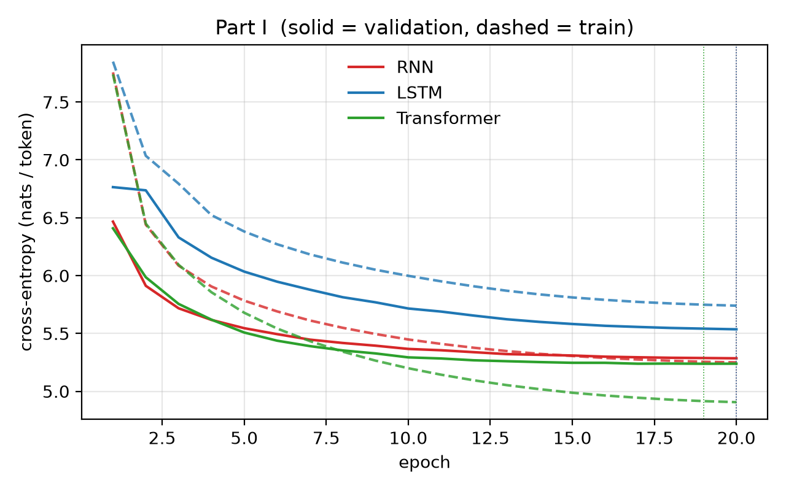
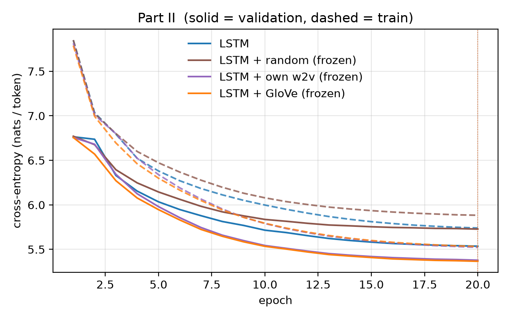
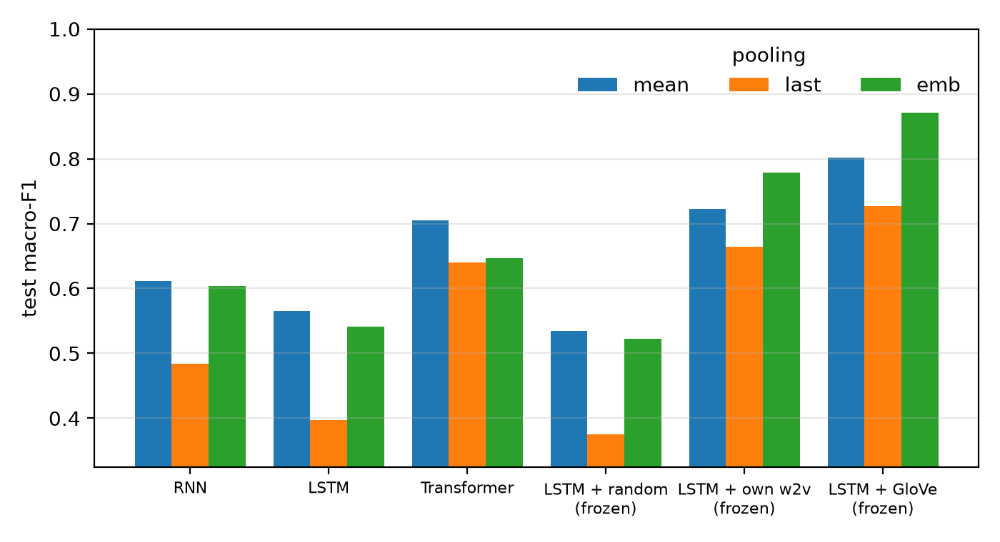
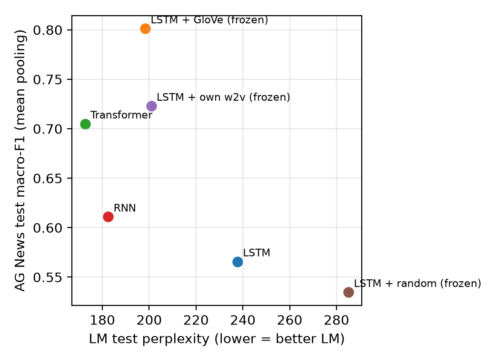

# Results summary

Auto-generated by `python run.py report`. All numbers come from the JSON files in `runs/` and `downstream/`.

## Corpus

```
{'vocab_size': 28913, 'train_tokens': 2075677, 'train_unk_rate': 0.02631671498022091, 'valid_tokens': 216347, 'valid_unk_rate': 0.05416298816253519, 'test_tokens': 244102, 'test_unk_rate': 0.062342791128298825}
```

## Hardware

```
{'device': 'cuda', 'torch': '2.11.0+cu128', 'python': '3.12.10', 'os': 'Windows 11', 'cpu': 'AMD64 Family 25 Model 97 Stepping 2, AuthenticAMD', 'cpu_count': 16, 'gpu': 'NVIDIA GeForce RTX 5070 Ti', 'gpu_mem_gb': 17.1}
```

## Run settings

```
{'SEQ_LEN': 128, 'BATCH_SIZE': 64, 'EMB_DIM': 100, 'HIDDEN': 256, 'DROPOUT': 0.3, 'LR': 0.001, 'WEIGHT_DECAY': 0.01, 'WARMUP_STEPS': 300, 'GRAD_CLIP': 1.0, 'SEED': 42, 'epochs': 20}
```

## Part I — language models

| model | valid ppl | test ppl | params (total) | core params | size MB | best epoch | train s | s/epoch | test tok/s | gen s |
|---|---|---|---|---|---|---|---|---|---|---|
| KN trigram | 236.0 | 221.4 | 2,608,089 entries | – | 46.19 | – | 0.26 | – | 4,777,143 | 0.074 |
| RNN | 197.4 | 182.5 | 10,545,173 | 223,232 | 42.18 | 20/20 | 137.28 | 6.86 | 800,917 | 0.179 |
| LSTM | 253.6 | 237.8 | 11,214,869 | 892,928 | 44.86 | 20/20 | 183.41 | 9.17 | 579,151 | 0.338 |
| Transformer | 188.3 | 172.6 | 11,435,285 | 1,113,344 | 45.74 | 19/20 | 124.96 | 6.25 | 994,543 | 0.413 |

n-gram timings are on CPU; neural timings on the device listed above.



### Generation repetition (sampled / greedy)

| model | distinct-1 | distinct-2 | repeated-trigram rate (sampled) | repeated-trigram rate (greedy) |
|---|---|---|---|---|
| KN trigram | 0.73 | 0.979 | 0.0 | 0.642 |
| RNN | 0.66 | 0.887 | 0.058 | 0.326 |
| LSTM | 0.61 | 0.851 | 0.063 | 0.484 |
| Transformer | 0.605 | 0.872 | 0.058 | 0.442 |
| LSTM + random (frozen) | 0.645 | 0.923 | 0.005 | 0.695 |
| LSTM + own w2v (frozen) | 0.63 | 0.897 | 0.016 | 0.832 |
| LSTM + GloVe (frozen) | 0.64 | 0.918 | 0.011 | 0.621 |

## Part II — embedding variants (LSTM)

| setting | valid ppl | test ppl | trainable params | best epoch | epoch-1 valid ppl | mean grad norm | max grad norm | clipped frac | type cov. | token cov. |
|---|---|---|---|---|---|---|---|---|---|---|
| LSTM | 253.6 | 237.8 | 11,214,869 | 20 | 866.4 | 0.226 | 1.429 | 0.01 | – | – |
| LSTM + random (frozen) | 307.3 | 285.2 | 8,323,569 | 20 | 871.9 | 0.207 | 1.432 | 0.01 | 0.0 | 0.0 |
| LSTM + own w2v (frozen) | 216.7 | 200.9 | 8,323,569 | 20 | 859.6 | 0.195 | 1.460 | 0.01 | 1.0 | 1.0 |
| LSTM + GloVe (frozen) | 214.1 | 198.4 | 8,323,569 | 20 | 859.6 | 0.215 | 1.588 | 0.01 | 0.9618 | 0.9474 |

Own word2vec training cost (separate from LM training): 22.8 s on CPU (gensim), 2,075,677 tokens, params {'vector_size': 100, 'window': 5, 'min_count': 1, 'sg': 1, 'negative': 5, 'epochs': 5, 'workers': 1, 'seed': 42}.

**LSTM + random (frozen)** — missing types: 28912; init: every row N(0, 0.4^2), seed 42; <pad> = 0; whole table frozen (control: no pretraining); most frequent missing: 
Embedding table changed during training: False (must be False).

**LSTM + own w2v (frozen)** — missing types: 0; init: N(0, 0.1780^2), seed 42; <pad> = 0; whole table frozen; most frequent missing: 
Embedding table changed during training: False (must be False).

**LSTM + GloVe (frozen)** — missing types: 1103; init: N(0, 0.4082^2), seed 42; <pad> = 0; whole table frozen; most frequent missing: <unk> (54625), <eos> (23767), @-@ (16906), @.@ (3194), @,@ (2699), 't (592), ° (258), − (82), 'brien (76), × (75), 'malley (54), magadheera (53)
Embedding table changed during training: False (must be False).



## Generated text (matched settings)

Sampling: temperature 0.8, top-k 40, 40 tokens, seed 1234+prompt index, <unk> banned = True. Greedy uses the same prompts.

**Prompt:** `the city is located in`

- *KN trigram* (sampled): the country 's independence from the british isles , the united states that the city , and on the night , and the british fleet in december 1943 , general , which caused her to be released in the early
- *RNN* (sampled): the world war . the first two days of the missouri river were the same day , on 1 january 1946 , and he took to be a first season and a small league in the season . <eos> =
- *LSTM* (sampled): the north of the first time and in the world to the second century . <eos> = = = <eos> = = = = background = = = <eos> when the storm in an new zealand was a year in
- *Transformer* (sampled): the east of the city of the national forest district for the university of athletics and the florida road , the city of texas street city , and city ( colorado . md 194 , the road was located in
- *LSTM + random (frozen)* (sampled): the north of the city . this , the british river the second of the church of the area , and the first two were moved in the central area @-@ century storm to the city in the north ,
- *LSTM + own w2v (frozen)* (sampled): the town , and the first half of the town @-@ prince ( the missouri of the highway was the largest of the southern and part @-@ century and ny ) and at september 18 , 2010 , when a
- *LSTM + GloVe (frozen)* (sampled): the island , and the first day in the southern terminus , it was estimated to the time of the central of the eastern states and a total of six feet , for this time of the gulf . it
- *KN trigram* (greedy): the united states , and the other hand , the first time in the united states , and the other hand , the first time in the united states , and the other hand , the first time in the
- *RNN* (greedy): the united states . <eos> = = = = = = = = <eos> the first time of the genus is a large @-@ shaped @-@ shaped @-@ shaped @-@ shaped @-@ shaped @-@ shaped @-@ shaped @-@ shaped @-@
- *LSTM* (greedy): the united states . <eos> = = = = = = = = = = = <eos> the first of the first time , the first of the first @-@ year , the first of the first time , the
- *Transformer* (greedy): the city of the city of the city . the city was built in the city of the city of the city of the city of the city of the city . the city was built in the city of
- *LSTM + random (frozen)* (greedy): the united states . <eos> = = = = = = = = = = = = = = = = = = = = = = = = = = = <eos> the first of the first of the
- *LSTM + own w2v (frozen)* (greedy): the united states . <eos> = = = = = = = = = = = = = = = = = = = = = = = = = = = = = = = = = = =
- *LSTM + GloVe (frozen)* (greedy): the united states . the first of the city of the city of the city of the city of the city of the city of the city of the city of the city of the city of the city of

**Prompt:** `in 1995 , the band released`

- *KN trigram* (sampled): the band in " galentine 's day . <eos> = = <eos> in the first to make both opening and the rest of the album , an early stage , and the surrounding the lake . the storm , the
- *RNN* (sampled): in his career : the song received mixed reviews from critics 's death , but he played . the first team in the united states was selected for the united states and the united states , and then won the
- *LSTM* (sampled): the new side – 4 @-@ class season . the the main brigade of the city also and the company was to be a time in the end of the united states . the game is a time in the
- *Transformer* (sampled): on june 5 , 2010 , 2015 . the album is the song 's album in 2013 <eos> = = = chart = = <eos> the album 's " was released in the united kingdom of the week , and
- *LSTM + random (frozen)* (sampled): to have the next in the 19th , and the episode @-@ up @-@ yard , while on the series of an year of the first week and the song of the same of their own . the song was
- *LSTM + own w2v (frozen)* (sampled): on september 17 by the national – 2009 . <eos> = = = = reception = = <eos> the best day on the album , " is an result of the series of a game . " we have been
- *LSTM + GloVe (frozen)* (sampled): to have a third @-@ year time of the episode and was certified by a " first greatest " , one as the album of the original game for the album 's band , but the game and a single
- *KN trigram* (greedy): the song was released on the billboard hot 100 , and the other hand , the first time in the united states , and the other hand , the first time in the united states , and the other hand
- *RNN* (greedy): in the united states . <eos> = = = = = = = = <eos> the album was released in the united states , and the first time of the season , and the first time of the season ,
- *LSTM* (greedy): the first time in the united states . <eos> = = = = = = = = = = = <eos> the first time of the first time , the first of the first of the first @-@ year ,
- *Transformer* (greedy): on the billboard hot 100 chart . the album peaked on the billboard hot 100 chart chart . the album peaked on the billboard hot 100 chart chart chart , peaking on the billboard hot 100 chart chart chart .
- *LSTM + random (frozen)* (greedy): of the first of the united states , and the first of the first of the first of the united states , and the first of the first of the first of the first of the united states , the
- *LSTM + own w2v (frozen)* (greedy): the album , and the song was released by the album , and the song was released by the album , and the song was released by the album , and the song was released by the album , and
- *LSTM + GloVe (frozen)* (greedy): the first single of the album , and the song was released by the album of the album , and the album was released by the album of the album , and the album was released by the album of

**Prompt:** `the game received`

- *KN trigram* (sampled): mixed reviews from critics , though he was also named the site . the main characters was used for more than four centuries , a few days , and the most impressive " like a movie with , which opened
- *RNN* (sampled): a year @-@ old version of the first year and the club , at the time of the show were relegated up at the age of the season . <eos> = = = = = = = <eos> a 10
- *LSTM* (sampled): the two in the first and the eastern league century . when the next area of the west end ; the next week in the city was one of the the eastern war of the new south division ( 21
- *Transformer* (sampled): the highest season . <eos> boise state was also the first highest @-@ team season , as a coach from the ball pitched to win the season . the final score was the first run on the two . somerset
- *LSTM + random (frozen)* (sampled): to create his own , where the new was used to help to find the first @-@ war series who as possible by the united states . <eos> = = = personal = = = <eos> the new york as
- *LSTM + own w2v (frozen)* (sampled): in the top @-@ yard season , he won his first player for the match . <eos> = = ratings = = <eos> the team was a final @-@ touchdown cup in the second league cup in the league state
- *LSTM + GloVe (frozen)* (sampled): the album was a first episode , as " in the video . dylan 's first song with ign noted that was described for " the song of the first version of the film . he he praised as writing
- *KN trigram* (greedy): mixed reviews from critics . <eos> = = = = = = = = = = = = = = = = = = = = = = = = = = = = = = = = = =
- *RNN* (greedy): a number of the game . <eos> = = = = = = = = <eos> the album was released in the united states , and the first time of the season , and the first time of the season
- *LSTM* (greedy): the first time in the united states . <eos> = = = = = = = = = = = <eos> the first time of the first time , the first of the first of the first @-@ year ,
- *Transformer* (greedy): the game . the game was released in the game , and the game 's game , the game was released in the game , and the game 's game , and the game 's game , and the game
- *LSTM + random (frozen)* (greedy): , and the first of the game of the game of the game of the united states . <eos> = = = = = = = = = = = = = = = = = = = = =
- *LSTM + own w2v (frozen)* (greedy): the first time . <eos> = = = = = = = = = = = = = = = = = = = = = = = = = = = = = = = = = = =
- *LSTM + GloVe (frozen)* (greedy): the first time of the game . <eos> = = = = = = = = = = = <eos> the first season , the first season , the first season , the first season , the first season ,

**Prompt:** `he was born in`

- *KN trigram* (sampled): may 2009 , the brigade were on the site of the war . <eos> = = <eos> the most part of the season . he served as the album was the first time in the uk , and by the
- *RNN* (sampled): 2011 . <eos> = = = = release = = = <eos> = = = <eos> the original film is a small @-@ language and film 's daughter and the song , and in the early 1990s , while it
- *LSTM* (sampled): the album . <eos> = = = = life = = = <eos> the first time of the episode are named for the british war , and the album was not the first first known . <eos> = = =
- *Transformer* (sampled): the united states . he was a total of the atlantic 's most of the united states in december 2011 . <eos> = = = = = = <eos> = = = = = = <eos> the first entry of
- *LSTM + random (frozen)* (sampled): the united states , and to the national on the site on the 19th of the war , in order , " the band is described in the time of the song . " <eos> a result of one 's
- *LSTM + own w2v (frozen)* (sampled): 2013 , it was a strong of the city of the year , the first year , with well " he and the british and three @-@ year @-@ year of the last world team was a first match ,
- *LSTM + GloVe (frozen)* (sampled): the united states . <eos> = = = production = = = <eos> in the early 1990s , an of the state of the british party was founded on the city , and is held at the united navy .
- *KN trigram* (greedy): the united states , and the other hand , the first time in the united states , and the other hand , the first time in the united states , and the other hand , the first time in the
- *RNN* (greedy): the united states . <eos> = = = = <eos> the first time of the season was a first @-@ year @-@ old @-@ year @-@ old @-@ year @-@ yard line . <eos> = = = = <eos> the
- *LSTM* (greedy): the united states . <eos> = = = = = = = = = = <eos> the first of the first time , the first of the first of the first @-@ year , the first of the first time
- *Transformer* (greedy): the united states . he was a member of the first time in the season , and was a result of the season . he was appointed manager in the season , and he was appointed manager . he was
- *LSTM + random (frozen)* (greedy): the united states , and the first of the first of the game of the game of the game , the first of the first of the game , the first of the first of the game , the first
- *LSTM + own w2v (frozen)* (greedy): the united states . <eos> = = = = = = = = = = = = = = = = = = = = = = = = = = = = = = = = = = =
- *LSTM + GloVe (frozen)* (greedy): the united states . <eos> = = = = = = = = = = = <eos> the first of the first year , the first year of the first year , the first year , the first season ,

**Prompt:** `during the war , the`

- *KN trigram* (sampled): british government . while in the country was converted into a tropical wave . <eos> the original series , guitar hero iii : legends of rock , the national liberation front for a number of stay @-@ at @-@ home
- *RNN* (sampled): ship had a tropical depression , at an intersection for the rest of an area of the ship , to the northeast of the town . <eos> the island was laid of a tropical storm @-@ mile ( 3 @.@
- *LSTM* (sampled): main war was used by the main river , as the first @-@ minute @-@ jamal between the war . <eos> after the year , the company is a year for the united states , it is a " the
- *Transformer* (sampled): national museum , as a result of independence , but many of the historic district . for the civil war , it was created by the galveston , and the town of galveston , was held by the national anthem
- *LSTM + random (frozen)* (sampled): city was the last of the north states . they returned in the early of the world of a series of their first week and the town . the next had reached a the two goal , and a tropical
- *LSTM + own w2v (frozen)* (sampled): most time of the german , and they were forced to the german forces . the most of a ship 's the ship could been been also on the town of the british division . the first of the british
- *LSTM + GloVe (frozen)* (sampled): the church was in the first 20th and the church of the church in the north bank of a a @-@ day @-@ based in the church . the name was born , the national navy was built to the
- *KN trigram* (greedy): first time in the united states , and the other hand , the first time in the united states , and the other hand , the first time in the united states , and the other hand , the first
- *RNN* (greedy): first time of the british empire , and the british battalion was a major @-@ class , and the ship was a major @-@ yard line . the ship was a tropical storm , and the storm was a tropical
- *LSTM* (greedy): first of the first time of the first time of the first time , and the first of the first time of the first time of the first time of the first time , and the first of the first
- *Transformer* (greedy): united states , the first time of the war . <eos> = = = = = = <eos> the war of the war , the croatian war , the croatian war was the first part of the croatian war .
- *LSTM + random (frozen)* (greedy): first of the first of the first of the first of the united states , the first of the first of the first of the first of the united states , the first of the first of the first of
- *LSTM + own w2v (frozen)* (greedy): first @-@ year , the first @-@ year , the first @-@ year , the first @-@ year , the first @-@ year , the first @-@ year , the first @-@ year , the first @-@ year , the
- *LSTM + GloVe (frozen)* (greedy): first of the first of the first year , the first of the first of the first year , the first of the first year , the first year of the first year , the first year , the first

## Part III — AG News with frozen LM representations

Train 10000, validation 2000, test 7600. Majority-class accuracy 0.25. Test-text <unk> rate 0.0713, mean length 44.0 tokens, truncated 0.0024.

| representation | dim | LM test ppl | C | test accuracy | test macro-F1 | per-class F1 (W/S/B/T) |
|---|---|---|---|---|---|---|
| RNN · mean | 256 | 182.5 | 0.1 | 0.612 | 0.611 | [0.6155, 0.7168, 0.537, 0.5747] |
| RNN · last | 256 | 182.5 | 0.01 | 0.49 | 0.4839 | [0.4834, 0.625, 0.3312, 0.496] |
| RNN · emb | 100 | 182.5 | 1.0 | 0.6055 | 0.604 | [0.6045, 0.7029, 0.5211, 0.5877] |
| LSTM · mean | 256 | 237.8 | 1.0 | 0.5664 | 0.5657 | [0.5899, 0.6246, 0.5342, 0.5144] |
| LSTM · last | 256 | 237.8 | 10.0 | 0.4004 | 0.3977 | [0.4109, 0.4558, 0.326, 0.3981] |
| LSTM · emb | 100 | 237.8 | 0.1 | 0.5425 | 0.5415 | [0.5388, 0.6037, 0.4927, 0.5309] |
| Transformer · mean | 256 | 172.6 | 1.0 | 0.7059 | 0.705 | [0.7145, 0.8233, 0.6262, 0.656] |
| Transformer · last | 256 | 172.6 | 0.1 | 0.6418 | 0.64 | [0.6555, 0.7765, 0.5219, 0.6059] |
| Transformer · emb | 100 | 172.6 | 10.0 | 0.6489 | 0.6466 | [0.6681, 0.7642, 0.5291, 0.625] |
| LSTM + random (frozen) · mean | 256 | 285.2 | 0.1 | 0.5357 | 0.5347 | [0.5284, 0.6163, 0.5097, 0.4844] |
| LSTM + random (frozen) · last | 256 | 285.2 | 10.0 | 0.3764 | 0.3747 | [0.3508, 0.4279, 0.3339, 0.3861] |
| LSTM + random (frozen) · emb | 100 | 285.2 | 0.1 | 0.5238 | 0.5228 | [0.5332, 0.5757, 0.5042, 0.4782] |
| LSTM + own w2v (frozen) · mean | 256 | 200.9 | 0.1 | 0.7239 | 0.723 | [0.7503, 0.8479, 0.618, 0.676] |
| LSTM + own w2v (frozen) · last | 256 | 200.9 | 0.1 | 0.6684 | 0.6648 | [0.7, 0.8169, 0.5121, 0.63] |
| LSTM + own w2v (frozen) · emb | 100 | 200.9 | 0.1 | 0.7796 | 0.7789 | [0.7897, 0.8917, 0.7064, 0.7277] |
| LSTM + GloVe (frozen) · mean | 256 | 198.4 | 1.0 | 0.8016 | 0.8012 | [0.8176, 0.9093, 0.7177, 0.7605] |
| LSTM + GloVe (frozen) · last | 256 | 198.4 | 0.01 | 0.7304 | 0.727 | [0.7596, 0.8643, 0.5741, 0.7099] |
| LSTM + GloVe (frozen) · emb | 100 | 198.4 | 0.1 | 0.8711 | 0.8707 | [0.8747, 0.95, 0.8197, 0.8386] |





### Disagreements between lstm:mean and transformer:mean

Counts: {'only_lstm:mean_right': 695, 'only_transformer:mean_right': 1755, 'both_wrong': 1540}

**Only the first is right**

- [World] (lstm:mean: World, transformer:mean: Business) Australian train crash injures scores A high-speed passenger train carrying more than 160 people jumped the rails and crashed in eastern Australia, injuring most of those on board, officials said.
- [Sports] (lstm:mean: Sports, transformer:mean: World) Ravens' Offensive Coordinator Resigns (AP) AP - Baltimore Ravens offensive coordinator Matt Cavanaugh resigned under pressure Monday after meeting with head coach Brian Billick, who finally lost patience with the team's sputtering attack.
- [World] (lstm:mean: World, transformer:mean: Sci/Tech) Japan steps up efforts for Iraq hostage release Japan has made last-ditch efforts to secure the release of a Japanese hostage facing execution in Iraq. A Japanese government official says efforts are still being made to free Shosei Koda, 24, but there have been no reports of any progress.
- [Business] (lstm:mean: Business, transformer:mean: World) Spanish buy Luton airport operator in 551m deal Luton Airport was bought by the Spanish yesterday as part of a 551m takeover deal which will net the men who run it almost 60m.
- [World] (lstm:mean: World, transformer:mean: Sports) 4 French schoolgirls expelled for wearing head scarves Two Muslim girls were expelled Wednesday from high school for refusing to remove their head scarf -- the fourth such expulsions in two days as officials began taking action against 
- [Sports] (lstm:mean: Sports, transformer:mean: World) Seahawks Looking at Acquiring Jerry Rice (AP) AP - Jerry Rice could be headed north to reunite with Seattle Seahawks coach Mike Holmgren.
- [Business] (lstm:mean: Business, transformer:mean: Sci/Tech) Bienvenue, Carrefour Lesser-known French retailer turns in a strong first half. Investors, take notice.
- [Sci/Tech] (lstm:mean: Sci/Tech, transformer:mean: Sports) Odd couple: Schwartz and McNealy It hasn't even been eight months since Sun Microsystems promoted Jonathan Schwartz to be Chief Executive Scott McNealy's right-hand man, but the two are already acting like an old couple. Missing Links

**Only the second is right**

- [Sci/Tech] (lstm:mean: Business, transformer:mean: Sci/Tech) CA offers usage-based pricing for mainframe tools OCTOBER 07, 2004 (IDG NEWS SERVICE) - Computer Associates International Inc. introduced a usage-based pricing and licensing option for its mainframe management products today, aligning its offerings with IBM #39;s on-demand model.
- [Business] (lstm:mean: World, transformer:mean: Business) Judge Threatens to Punish MCI Over Fees It Has Paid The judge who presided over the Securities and Exchange Commission #39;s fraud suit against MCI, the long-distance telephone company, threatened to punish the company yesterday for ignoring his 
- [Sci/Tech] (lstm:mean: Business, transformer:mean: Sci/Tech) Something Oozed on Titan #39;s Surface Summary - (Nov 8, 2004) NASA #39;s Cassini spacecraft took this image of Titan as it sped past the moon on Oct. 26, 2004. It was taken from an altitude of 2,500 km (1,553 miles) using the spacecraft #39;s aperture 
- [World] (lstm:mean: Sci/Tech, transformer:mean: World) Kerry assails Bush troop withdrawal plan (AFP) AFP - Democratic White House hopeful Senator John Kerry warned that President George W. Bush's plan to withdraw 70,000 troops from Europe and Asia would hinder the war on terrorism and embolden North Korea.
- [Business] (lstm:mean: World, transformer:mean: Business) Unskilled jobs to go There will be no jobs for unskilled workers in Britain within 10 years, the leading employers #39; organisation claims today. The prediction is based on the growth in 
- [Sci/Tech] (lstm:mean: Sports, transformer:mean: Sci/Tech) Apple Sailing on Digital River the iPod -s a nifty little device, primarily allowing you to listen to downloaded music, but also giving you the opportunity 
- [Business] (lstm:mean: Sci/Tech, transformer:mean: Business) Microsoft Ends Decade of Antitrust Suits  SEATTLE/NEW YORK (Reuters) - Microsoft Corp. &lt;A HREF="http://www.investor.reuters.com/FullQuote.aspx?ticker=MSFT.O target=/stocks/quickinfo/fullquote"&gt;MSFT.O&lt;/A&gt; said  on Monday it had agreed to settle antitrust lawsuits with  Novell Inc. &lt;A H
- [World] (lstm:mean: Business, transformer:mean: World) Fierce Clashes in Iraq Kill 36; 203 Hurt US troops battled Shiite militiamen loyal to rebel cleric Muqtada al-Sadr in the Baghdad slum of Sadr City on Tuesday in fierce fighting that killed 36 people, including 

**Both wrong**

- [Sports] (lstm:mean: Business, transformer:mean: Sci/Tech) Ichiro with 260 hits, Writes First New Chapter in 84 Years Japans  quot;Baseball talent quot; Suzuki Ichiro (31,Seattle Mariners) has leapfrogged 84 years of outdated records of most hits in a season and stepped into the 260-hit peak.
- [Business] (lstm:mean: Sports, transformer:mean: Sports) Board with Mukesh: Reliance Mumbai, Nov. 26: Mukesh Ambani apparently commands the full support of the board on all recent decisions, including the controversial one that elevated him to the final authority in the group.
- [Business] (lstm:mean: World, transformer:mean: World) Arthritis drug withdrawn after trial A prescription painkiller used by more than 250,000 Australians to treat arthritis has been withdrawn from sale after a clinical trial found it doubled the risk of heart attack and stroke.
- [Business] (lstm:mean: Sci/Tech, transformer:mean: Sci/Tech) IBM reported to be exiting PC business IBM #39;s possible exit from the personal-computer business would be the latest move in what amounts to a long goodbye from a field it pioneered and revolutionized.
- [Sci/Tech] (lstm:mean: Business, transformer:mean: Business) Microsoft prepares to ship new corporate IM server A little over a year after introducing the first version of Office Live Communications Server, Microsoft Corp. in December plans to release the next version of its enterprise instant messaging software, it said Monday.
- [Business] (lstm:mean: Sports, transformer:mean: Sci/Tech) FM, Reddy to attend IMF-WB meet Finance Minister P Chidambaram will lead a high-level delegation for the annual IMF-World Bank meeting in Washington from October 1, where New Delhi would press for higher aid flows for infrastructure and social development.
- [Sci/Tech] (lstm:mean: World, transformer:mean: World) Global Warming May Spur Fiercer Hurricanes - Experts (Reuters) Reuters - As Hurricane Ivan and its powerful\winds churned through the Gulf of Mexico, scientists told\Congress on Wednesday that global warming could produce\stronger and more destructive hurricanes in the future.
- [Sports] (lstm:mean: World, transformer:mean: World) Spain Condemns Racial Abuse, Defends Reputation  MADRID (Reuters) - The Madrid council has condemned the  racist behavior of fans that marred Wednesday's friendly  between Spain and England and said that the events should not  be allowed to harm the city's bid to host the 2012 Olympics.
