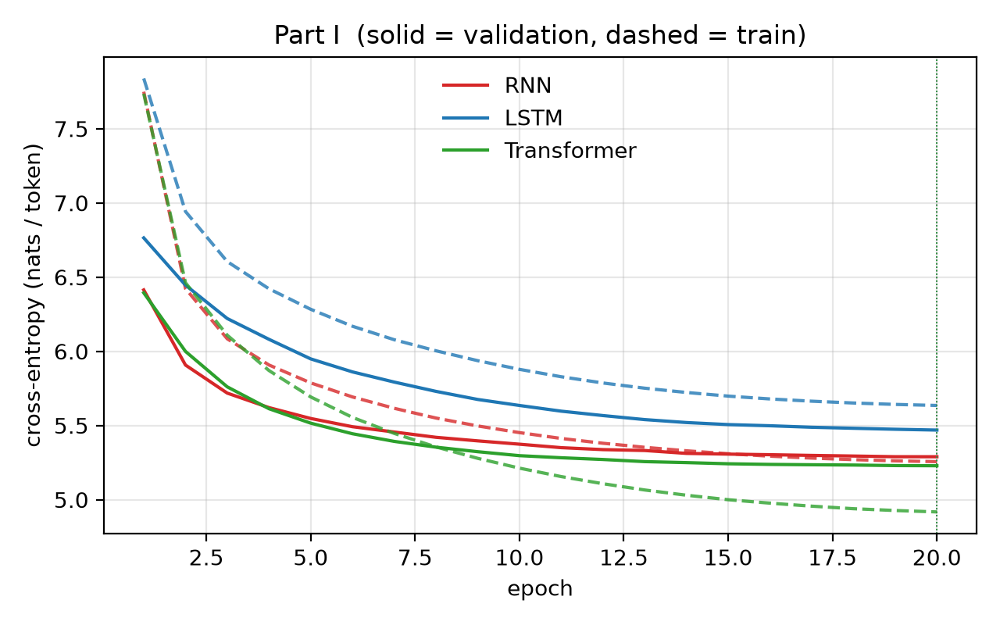
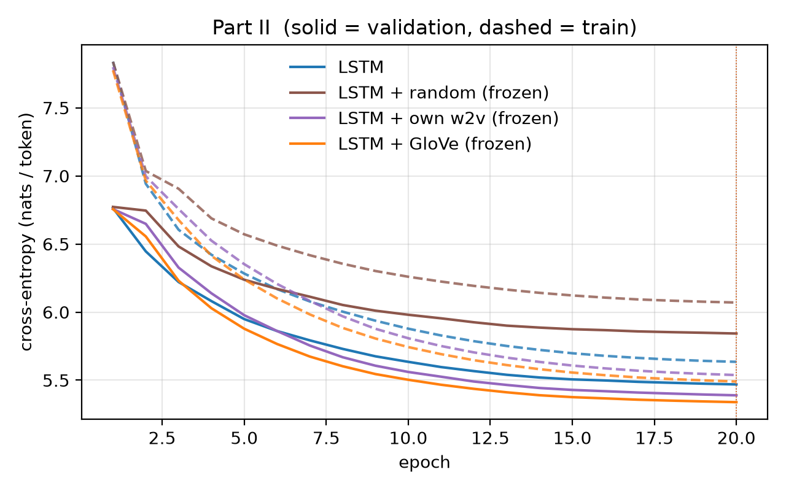
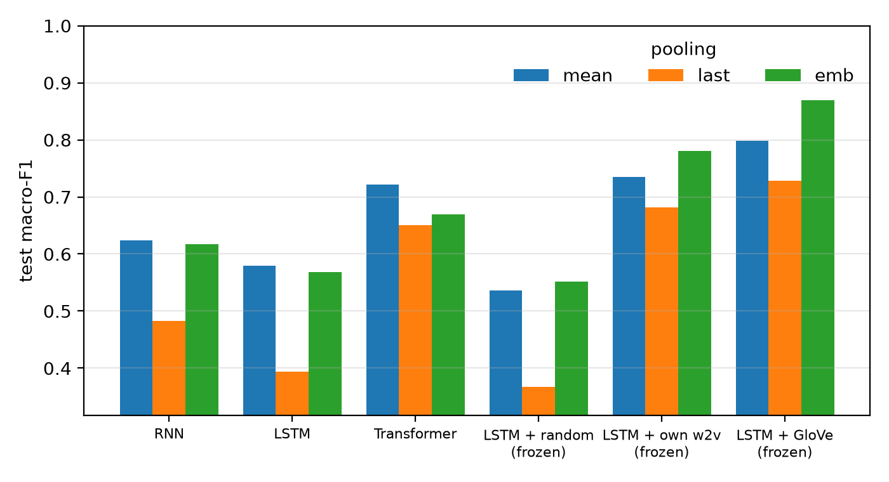
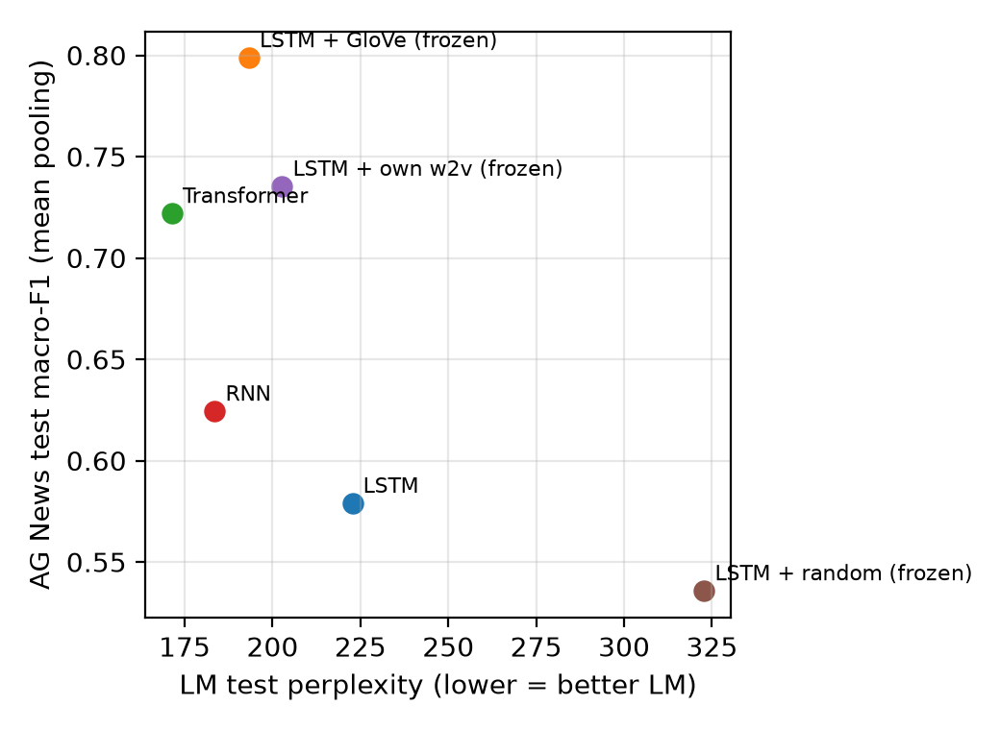

# Results summary

Auto-generated by `python run.py report`. All numbers come from the JSON files in `runs/` and `downstream/`.

## Corpus

```
{'vocab_size': 28913, 'train_tokens': 2075677, 'train_unk_rate': 0.02631671498022091, 'valid_tokens': 216347, 'valid_unk_rate': 0.05416298816253519, 'test_tokens': 244102, 'test_unk_rate': 0.062342791128298825}
```

## Hardware

```
{'device': 'cuda', 'torch': '2.11.0+cu128', 'python': '3.12.10', 'os': 'Windows 11', 'cpu': 'AMD64 Family 25 Model 97 Stepping 2, AuthenticAMD', 'cpu_count': 16, 'gpu': 'NVIDIA GeForce RTX 5070 Ti', 'gpu_mem_gb': 17.1}
```

## Run settings

```
{'SEQ_LEN': 128, 'BATCH_SIZE': 64, 'EMB_DIM': 100, 'HIDDEN': 256, 'DROPOUT': 0.3, 'LR': 0.001, 'WEIGHT_DECAY': 0.01, 'WARMUP_STEPS': 300, 'GRAD_CLIP': 1.0, 'SEED': 7, 'epochs': 20}
```

## Part I — language models

| model | valid ppl | test ppl | params (total) | core params | size MB | best epoch | train s | s/epoch | test tok/s | gen s |
|---|---|---|---|---|---|---|---|---|---|---|
| KN trigram | 236.0 | 221.4 | 2,608,089 entries | – | 46.19 | – | 0.22 | – | 5,709,404 | 0.073 |
| RNN | 198.2 | 183.6 | 10,545,173 | 223,232 | 42.18 | 20/20 | 122.4 | 6.12 | 876,907 | 0.231 |
| LSTM | 237.2 | 222.7 | 11,214,869 | 892,928 | 44.86 | 20/20 | 183.5 | 9.18 | 526,290 | 0.367 |
| Transformer | 186.5 | 171.4 | 11,435,285 | 1,113,344 | 45.74 | 20/20 | 123.0 | 6.15 | 1,094,588 | 0.317 |

n-gram timings are on CPU; neural timings on the device listed above.



### Generation repetition (sampled / greedy)

| model | distinct-1 | distinct-2 | repeated-trigram rate (sampled) | repeated-trigram rate (greedy) |
|---|---|---|---|---|
| KN trigram | 0.73 | 0.979 | 0.0 | 0.642 |
| RNN | 0.665 | 0.908 | 0.037 | 0.289 |
| LSTM | 0.67 | 0.954 | 0.005 | 0.6 |
| Transformer | 0.705 | 0.918 | 0.016 | 0.505 |
| LSTM + random (frozen) | 0.635 | 0.897 | 0.021 | 0.858 |
| LSTM + own w2v (frozen) | 0.665 | 0.923 | 0.016 | 0.611 |
| LSTM + GloVe (frozen) | 0.61 | 0.856 | 0.032 | 0.705 |

## Part II — embedding variants (LSTM)

| setting | valid ppl | test ppl | trainable params | best epoch | epoch-1 valid ppl | mean grad norm | max grad norm | clipped frac | type cov. | token cov. |
|---|---|---|---|---|---|---|---|---|---|---|
| LSTM | 237.2 | 222.7 | 11,214,869 | 20 | 866.3 | 0.202 | 1.443 | 0.01 | – | – |
| LSTM + random (frozen) | 344.7 | 322.8 | 8,323,569 | 20 | 873.3 | 0.233 | 1.441 | 0.01 | 0.0 | 0.0 |
| LSTM + own w2v (frozen) | 219.0 | 202.8 | 8,323,569 | 20 | 859.4 | 0.200 | 1.471 | 0.01 | 1.0 | 1.0 |
| LSTM + GloVe (frozen) | 208.3 | 193.3 | 8,323,569 | 20 | 859.2 | 0.209 | 1.484 | 0.01 | 0.9618 | 0.9474 |

Own word2vec training cost (separate from LM training): 22.9 s on CPU (gensim), 2,075,677 tokens, params {'vector_size': 100, 'window': 5, 'min_count': 1, 'sg': 1, 'negative': 5, 'epochs': 5, 'workers': 1, 'seed': 7}.

**LSTM + random (frozen)** — missing types: 28912; init: every row N(0, 0.4^2), seed 7; <pad> = 0; whole table frozen (control: no pretraining); most frequent missing: 
Embedding table changed during training: False (must be False).

**LSTM + own w2v (frozen)** — missing types: 0; init: N(0, 0.1780^2), seed 7; <pad> = 0; whole table frozen; most frequent missing: 
Embedding table changed during training: False (must be False).

**LSTM + GloVe (frozen)** — missing types: 1103; init: N(0, 0.4082^2), seed 7; <pad> = 0; whole table frozen; most frequent missing: <unk> (54625), <eos> (23767), @-@ (16906), @.@ (3194), @,@ (2699), 't (592), ° (258), − (82), 'brien (76), × (75), 'malley (54), magadheera (53)
Embedding table changed during training: False (must be False).



## Generated text (matched settings)

Sampling: temperature 0.8, top-k 40, 40 tokens, seed 1234+prompt index, <unk> banned = True. Greedy uses the same prompts.

**Prompt:** `the city is located in`

- *KN trigram* (sampled): the country 's independence from the british isles , the united states that the city , and on the night , and the british fleet in december 1943 , general , which caused her to be released in the early
- *RNN* (sampled): the state . <eos> = = = the area = = = <eos> the noisy miner is currently by a small @-@ shaped in size and a large pressure is an extension with two years . <eos> = = =
- *LSTM* (sampled): the south @-@ day , and is not a @-@ two @-@ century @-@ month in the country . the system was a " one of a " two more in " when they is a single of the "
- *Transformer* (sampled): the western town of the city and north of the river . this is listed in the state of newark . the highway of md 194 road , it consists of sr island to the south west of the north
- *LSTM + random (frozen)* (sampled): the late , and the first @-@ the first day with the city of the west of the time of a new . however 's early of the book with the new with their , and also was built in
- *LSTM + own w2v (frozen)* (sampled): the island , and the city is located in the island of the town at the 19th 's 19th . <eos> = = = background = <eos> the noisy 's main species 's population , the genus of the church
- *LSTM + GloVe (frozen)* (sampled): the late day . the first year in the uk . the main of the end of the area was the first of the end of a single storm as the largest population and the main depression of the north
- *KN trigram* (greedy): the united states , and the other hand , the first time in the united states , and the other hand , the first time in the united states , and the other hand , the first time in the
- *RNN* (greedy): the united states . the first of the largest government was built in the united states . the first phase of the storm was built in the united states . the first day of the storm was the first time
- *LSTM* (greedy): the united states . <eos> = = = = = = = = = = = = = = <eos> the first of the first of the first of the first time , the first of the first time ,
- *Transformer* (greedy): the city of the city of the city of the city of the city of the city of haifa . the haifa is the city of haifa , the city of haifa , and the city of haifa , haifa
- *LSTM + random (frozen)* (greedy): the united states . <eos> = = = = = = = = = = <eos> = = = = = = = = = = <eos> = = = = = = = = = = <eos> = =
- *LSTM + own w2v (frozen)* (greedy): the united states . <eos> = = = = = = = = = = = = <eos> the first @-@ @-@ @-@ @-@ @-@ @-@ @-@ @-@ @-@ @-@ @-@ @-@ @-@ @-@ @-@ @-@ @-@ @-@ @-@ @-@
- *LSTM + GloVe (frozen)* (greedy): the united states . the first of the first of the first century of the united states , the first of the first century of the united states , the first of the first century century , the first of

**Prompt:** `in 1995 , the band released`

- *KN trigram* (sampled): the band in " galentine 's day . <eos> = = <eos> in the first to make both opening and the rest of the album , an early stage , and the surrounding the lake . the storm , the
- *RNN* (sampled): a " new hop " , saying that the song of the series of a new song by the recording award . <eos> = = = casting , = = = <eos> the episode 's best game had a positive
- *LSTM* (sampled): the game , or the latter were found by the royal time . the song 's most successful , is now known as a " @-@ way in the world of the war , which is a good " ,
- *Transformer* (sampled): on november 25 when the album did not be released on august 3 . <eos> = = production = = <eos> credits and certifications = = <eos> in june 2005 , the album debuted by a recording album . the
- *LSTM + random (frozen)* (sampled): to have the main in the late , and the original @-@ century @-@ year , he will be given with its own . <eos> the following 's @-@ first of the main , which is a major @-@ yard
- *LSTM + own w2v (frozen)* (sampled): to play with more than the previous week . <eos> = = = reception = = <eos> while the best in number of the album 's final game and the album was released by an first series with a single
- *LSTM + GloVe (frozen)* (sampled): on november 17 by the title as a single @-@ number . he also released on march 2004 , on the episode , the song of the game in the album , carey was nominated in the end . <eos>
- *KN trigram* (greedy): the song was released on the billboard hot 100 , and the other hand , the first time in the united states , and the other hand , the first time in the united states , and the other hand
- *RNN* (greedy): the song of the album , and the song was released in the united states . <eos> = = = = = = = = = <eos> the album was released in the united states , and the first time
- *LSTM* (greedy): the first time of the united states . <eos> = = = = = = = = = = = = = = <eos> the first of the first of the first of the first time , the first of
- *Transformer* (greedy): on the billboard hot 100 chart . the album debuted on the billboard hot 100 chart . the album peaked on the billboard hot 100 chart , the album peaked on the billboard hot 100 chart . the album peaked
- *LSTM + random (frozen)* (greedy): of the first of the first of the first of the first of the first of the first of the first of the first of the first of the first of the first of the first of the first of
- *LSTM + own w2v (frozen)* (greedy): the album , the song was released by the album , and the song was released by the album , and the song was released by the album , and the song was released by the album , and the
- *LSTM + GloVe (frozen)* (greedy): in the united states , and the song was released by the album of the album . <eos> = = = = = = = = = = = = = = = = = = = = = =

**Prompt:** `the game received`

- *KN trigram* (sampled): mixed reviews from critics , though he was also named the site . the main characters was used for more than four centuries , a few days , and the most impressive " like a movie with , which opened
- *RNN* (sampled): the season on the chart " , a new @-@ star disc . by the end of the end film , was released the album , and released in the video with the best albums and is nominated , that
- *LSTM* (sampled): the other year . the two @-@ time of the song did not go to the second side of any state and the state and the first two @-@ . a strong @-@ century line and the team had increased
- *Transformer* (sampled): the most memorable awards , who had been nominated on the screen and its previous year . <eos> his parents was featured in the series of the video game for the show 's most memorable awards in the world records
- *LSTM + random (frozen)* (sampled): in the game . the city was to have that the church was , but the film for these has been considered with the " . <eos> = = = reception = = = <eos> a man . this will
- *LSTM + own w2v (frozen)* (sampled): the final . <eos> the following year , a game was ranked by the top of the world with eight appearances ; and had the first @-@ round @-@ season and final on the team in the club to move
- *LSTM + GloVe (frozen)* (sampled): the team for the game was the first team for the year . despite the first of the following later , but it was also a first single of the match of the united states and federer as one new
- *KN trigram* (greedy): mixed reviews from critics . <eos> = = = = = = = = = = = = = = = = = = = = = = = = = = = = = = = = = =
- *RNN* (greedy): the first time , and the first time , the first game was released in the united states . <eos> = = = = = = = = = <eos> the album was released in the united states , and
- *LSTM* (greedy): the first time . <eos> = = = = = = = = = = = = = = = <eos> the first of the first of the first of the first time , the first of the first time
- *Transformer* (greedy): the first game . the game was released in the game , the game 's game , and the game was released in the game , and the game 's game , and the game 's game , and the
- *LSTM + random (frozen)* (greedy): , and the first of the first of the first of the first of the first of the first of the first of the first of the first of the first of the first of the first of the first
- *LSTM + own w2v (frozen)* (greedy): the first time . <eos> = = = = = = = = = = = = <eos> the first @-@ year , the first @-@ year , the first @-@ year , the first @-@ year , the first
- *LSTM + GloVe (frozen)* (greedy): the first season . <eos> = = = = = = = = = = = = = = = = = = = = = = = = = = = = = = = = = = =

**Prompt:** `he was born in`

- *KN trigram* (sampled): may 2009 , the brigade were on the site of the war . <eos> = = <eos> the most part of the season . he served as the album was the first time in the uk , and by the
- *RNN* (sampled): the united states . <eos> = = = reception = = = <eos> in the early 1950s , nesbitt has been considered to the first three months of the album 's best album to an official studio album was released
- *LSTM* (sampled): the episode ; the video were a variety of the main century , and the album were found from the final time . the game was also considered the first @-@ @-@ @-@ star in new york , to the
- *Transformer* (sampled): the first three @-@ year – 0 victory over the 2005 year , he was appointed the phillies against bolton wanderers . he took his first appearance in the first round in the fourth – 5 – 0 lead win
- *LSTM + random (frozen)* (sampled): the north of the national time . <eos> = = = career = = = <eos> = = production = = <eos> the following 's song was written , and was the first and new and the first river .
- *LSTM + own w2v (frozen)* (sampled): which he was a single on the late states . the city , the first time of the second world , who was elected by the university of the first @-@ @-@ @-@ time and " the " friend ,
- *LSTM + GloVe (frozen)* (sampled): the united states . <eos> = = = other = = = <eos> the first time of the city were one " the team , one of the player of the first season in the club . <eos> for the
- *KN trigram* (greedy): the united states , and the other hand , the first time in the united states , and the other hand , the first time in the united states , and the other hand , the first time in the
- *RNN* (greedy): the united states . <eos> = = = = = = = = = <eos> the film was released in the united states , and the first time of the album , and the song was released in the united
- *LSTM* (greedy): the united states . <eos> = = = = = = = = = = = = = = <eos> the first of the first of the first of the first time , the first of the first time ,
- *Transformer* (greedy): the first round of the season . he was a second season in the season , but he was a first season in the season . he was a first season in the season , he was named in the
- *LSTM + random (frozen)* (greedy): the united states . <eos> = = = = = = = = = = <eos> = = = = = = = = = = <eos> = = = = = = = = = = <eos> = =
- *LSTM + own w2v (frozen)* (greedy): the united states . <eos> = = = = = = = = = = = = = <eos> the first of the first year , the first of the first year , the first of the first year ,
- *LSTM + GloVe (frozen)* (greedy): the united states . <eos> = = = = = = = = = = = = = = = = = = = = = = = = = = = = = = = = = = =

**Prompt:** `during the war , the`

- *KN trigram* (sampled): british government . while in the country was converted into a tropical wave . <eos> the original series , guitar hero iii : legends of rock , the national liberation front for a number of stay @-@ at @-@ home
- *RNN* (sampled): state was held with a new area to the rear of the missouri in the town of the region . <eos> after the time , the viet cong was killed at the time , and on august 14 , the
- *LSTM* (sampled): song is the new zealand , it are a member of the new game . the band was completed by the new york league of the british army . <eos> the film is a tropical american , and a new
- *Transformer* (sampled): germans was an hour of the american naval vessel at the battle of her own and one of her own class in the country . she was commissioned in the british ship , she was completed by the austro @-@
- *LSTM + random (frozen)* (sampled): same was the second @-@ year – 5 in the town , which are a member was made by the new @-@ year with the new of the year . the next of the album also is a the "
- *LSTM + own w2v (frozen)* (sampled): song had a first of the american and the british football of the national @-@ and was a small time of their own time . <eos> = = = = to release , = = = = <eos> in the
- *LSTM + GloVe (frozen)* (sampled): church was sent the north of the area of the missouri river and south and then not be replaced and the ship of the north of the eastern army . the united of the government @-@ class of the city
- *KN trigram* (greedy): first time in the united states , and the other hand , the first time in the united states , and the other hand , the first time in the united states , and the other hand , the first
- *RNN* (greedy): first time of the season was a major force of the city . <eos> = = = = = = = = <eos> the missouri river was built in the united states , and the first time of the city
- *LSTM* (greedy): first of the first time , the first of the first time , the first of the first time , and the first of the first time , the first of the first time , and the first of the
- *Transformer* (greedy): war of the war , the war of the war , the war of the war . the war was the first army of the war , and the war of the war , the war of the war ,
- *LSTM + random (frozen)* (greedy): first of the first of the first of the first of the first of the first of the first of the first of the first of the first of the first of the first of the first of the first
- *LSTM + own w2v (frozen)* (greedy): first of the first time of the war , the first of the war , the first of the war , the first of the war of the war , the church was a member of the church of the
- *LSTM + GloVe (frozen)* (greedy): first of the first time of the war of the war of the war of the war of the war of the war of the war of the war of the war of the war of the war of the

## Part III — AG News with frozen LM representations

Train 10000, validation 2000, test 7600. Majority-class accuracy 0.25. Test-text <unk> rate 0.0713, mean length 44.0 tokens, truncated 0.0024.

| representation | dim | LM test ppl | C | test accuracy | test macro-F1 | per-class F1 (W/S/B/T) |
|---|---|---|---|---|---|---|
| RNN · mean | 256 | 183.6 | 0.1 | 0.625 | 0.6243 | [0.6212, 0.7215, 0.5746, 0.58] |
| RNN · last | 256 | 183.6 | 0.01 | 0.4892 | 0.483 | [0.4537, 0.6331, 0.3455, 0.4999] |
| RNN · emb | 100 | 183.6 | 1.0 | 0.6178 | 0.6169 | [0.5923, 0.7138, 0.5695, 0.5921] |
| LSTM · mean | 256 | 222.7 | 10.0 | 0.5799 | 0.5789 | [0.5944, 0.637, 0.5521, 0.5319] |
| LSTM · last | 256 | 222.7 | 0.1 | 0.3963 | 0.3937 | [0.4089, 0.4406, 0.3154, 0.4098] |
| LSTM · emb | 100 | 222.7 | 0.1 | 0.5683 | 0.5679 | [0.5521, 0.6027, 0.5545, 0.5624] |
| Transformer · mean | 256 | 171.4 | 1.0 | 0.7232 | 0.7219 | [0.7375, 0.8313, 0.6489, 0.6698] |
| Transformer · last | 256 | 171.4 | 0.1 | 0.6518 | 0.6503 | [0.6719, 0.7916, 0.5394, 0.5984] |
| Transformer · emb | 100 | 171.4 | 0.01 | 0.6697 | 0.6689 | [0.6668, 0.769, 0.5971, 0.6427] |
| LSTM + random (frozen) · mean | 256 | 322.8 | 10.0 | 0.5362 | 0.5357 | [0.5338, 0.5891, 0.5105, 0.5093] |
| LSTM + random (frozen) · last | 256 | 322.8 | 0.1 | 0.3686 | 0.3672 | [0.3856, 0.3951, 0.3287, 0.3594] |
| LSTM + random (frozen) · emb | 100 | 322.8 | 0.01 | 0.553 | 0.5517 | [0.56, 0.6284, 0.5052, 0.5131] |
| LSTM + own w2v (frozen) · mean | 256 | 202.8 | 0.1 | 0.7367 | 0.7353 | [0.7593, 0.8524, 0.6408, 0.6889] |
| LSTM + own w2v (frozen) · last | 256 | 202.8 | 0.01 | 0.6851 | 0.682 | [0.7254, 0.8046, 0.5413, 0.6565] |
| LSTM + own w2v (frozen) · emb | 100 | 202.8 | 0.1 | 0.7809 | 0.7802 | [0.7902, 0.8999, 0.7054, 0.7251] |
| LSTM + GloVe (frozen) · mean | 256 | 193.3 | 10.0 | 0.7993 | 0.7987 | [0.8158, 0.9124, 0.7119, 0.7547] |
| LSTM + GloVe (frozen) · last | 256 | 193.3 | 1.0 | 0.7305 | 0.7287 | [0.7588, 0.8754, 0.5901, 0.6905] |
| LSTM + GloVe (frozen) · emb | 100 | 193.3 | 0.1 | 0.87 | 0.8697 | [0.8724, 0.9476, 0.8211, 0.8378] |





### Disagreements between lstm:mean and transformer:mean

Counts: {'only_lstm:mean_right': 657, 'only_transformer:mean_right': 1746, 'both_wrong': 1447}

**Only the first is right**

- [World] (lstm:mean: World, transformer:mean: Sports) Australia establish 300-run lead in third India Test (AFP) AFP - Australia batted cautiously in their second innings to build a lead of 300 runs over India with nine wickets in hand in the third cricket Test here.
- [Sci/Tech] (lstm:mean: Sci/Tech, transformer:mean: World) Worldpay struck by online attack Net payment system Worldpay is under attack from hackers delaying transaction times for hundreds of online retailers.
- [Business] (lstm:mean: Business, transformer:mean: Sci/Tech) Nektar Shares Continues Rise on Upgrades Shares of Nektar Therapeutics remained active Wednesday following upgrades from two investment firms after drug giant Pfizer Inc. cited its inhalable insulin product in a recent pipeline report.
- [Sports] (lstm:mean: Sports, transformer:mean: Sci/Tech) Cricket swings to Calypso once again From the time you touch down in the British Isles, you get an overwhelming sense of grey. The skies are almost always leaden, the clothes people wear are generally either black or neutral shades guaranteed 
- [World] (lstm:mean: World, transformer:mean: Sci/Tech) Court Declines to Hear Gay Marriage Case (AP) AP - The Supreme Court on Monday sidestepped a dispute over gay marriages, rejecting a challenge to the nation's only law sanctioning such unions.
- [Sci/Tech] (lstm:mean: Sci/Tech, transformer:mean: World) 'Smelly' mates guide seabirds Seabirds called prions, which mate for life, find their nests by sniffing out their partners, scientists say.
- [Sci/Tech] (lstm:mean: Sci/Tech, transformer:mean: Business) Calif. Aims to Limit Farm-Related Smog (AP) AP - Southern California's smog-fighting agency went after emissions of the bovine variety Friday, adopting the nation's first rules to reduce air pollution from dairy cow manure.
- [World] (lstm:mean: World, transformer:mean: Business) Japan to Protest to China Over Intruder Submarine  TOKYO (Reuters) - Japan will protest to China after  concluding that a nuclear-powered submarine that intruded into  its waters this week belonged to the Chinese navy, top  government spokesman Hiroyuki Hosoda said on Friday.

**Only the second is right**

- [Sports] (lstm:mean: Business, transformer:mean: Sports) Transactions BASEBALL Boston (AL): Activated DH Ellis Burks from the 60-day disabled list; released P Phil Seibel. Milwaukee (NL): Sent INF Matt Erickson outright to Indianapolis (IL).
- [Sports] (lstm:mean: Sci/Tech, transformer:mean: Sports) There #39;s a lot on the line for drivers at Richmond this weekend RICHMOND, Va. - Its the 26th race of the Nextel Cup season, and for the first time in the sports history, a season will end before, well, the season.
- [World] (lstm:mean: Business, transformer:mean: World) Feed-Tube Law Is Struck Down in Florida Case The court said that Gov. Jeb Bush violated separation of powers when he signed a law to keep Theresa Schiavo alive.
- [World] (lstm:mean: Business, transformer:mean: World) Gunfire Erupts in Pro-Aristide Haiti Slum PORT-AU-PRINCE, Haiti Oct. 3, 2004 - Gunfire erupted in a slum teeming with loyalists of ousted President Jean-Bertrand Aristide on Sunday, sending people scattering through trash-strewn streets following 
- [Sports] (lstm:mean: Sci/Tech, transformer:mean: Sports) King Singh ... at last! The No. 1 golfer in the world is on his way to Glen Abbey for this week #39;s Canadian Open. No, Tiger Woods hasn #39;t changed his plans.
- [Business] (lstm:mean: World, transformer:mean: Business) Service Sector Hit By High Oil Costs Confidence in service firms has been hit by rising oil prices and interest rates but manufacturers have seen the best rate of orders for nine years, two surveys show.
- [Sports] (lstm:mean: Sci/Tech, transformer:mean: Sports) Pedro, GM welcome challenge that awaits The Boston Red Sox could offer Pedro Martinez the still-dizzying celebration of a city that he helped to a historic World Series championship.
- [Sci/Tech] (lstm:mean: Sports, transformer:mean: Sci/Tech) AMD Launches Low-Cost Web Device Advanced Micro Devices is launching a low-cost Internet access device dubbed  quot;PIC, quot; or personal Internet communicator, targeted at first-time computer users in the developing world.

**Both wrong**

- [Business] (lstm:mean: Sci/Tech, transformer:mean: Sci/Tech) HP to tempt holiday shoppers with sights and sounds The computer-hardware giant, best known for products such as PCs and printers, on Friday laid out its plan to become a brand-name in consumer electronics products such as flat-screen TVs, music players and the devices that move content between them
- [World] (lstm:mean: Business, transformer:mean: Business) U.N.: N.Korea Sends Positive Message on Nuke Talks  SEOUL (Reuters) - North Korea gave a visiting U.N. official  a "very positive message" about resuming stalled six-way talks  on its nuclear programs, the South Korean Unification Ministry  said Wednesday.
- [Sci/Tech] (lstm:mean: World, transformer:mean: World) Earthquake 'redraws the map' The devastating earthquake that struck the Indian Ocean probably caused some islands to move by several metres.
- [Sci/Tech] (lstm:mean: World, transformer:mean: Business) Storage, servers bruise HP earnings update Earnings per share rise compared with a year ago, but company misses analysts' expectations by a long shot.
- [Business] (lstm:mean: Sci/Tech, transformer:mean: Sports) Med school move delayed to 2007 The MSU College of Human Medicine won #39;t be relocated to Grand Rapids until at least 2007, and could cost only half as much as university officials originally estimated.
- [Business] (lstm:mean: Sci/Tech, transformer:mean: Sci/Tech) Product Previews palmOneUpgrades Treo With Faster Chip, Better Display\With more than 600,000 units shipped, the Treo 600 is one of the big smartphone success stories. Last week, palmOne introduced the follow-on Treo 650 with a higher resolution 320-by-320-pixel TFT screen, which the company claims 
- [Sci/Tech] (lstm:mean: World, transformer:mean: World) Brits to lose 12 current of IT jobs by 2010 New report on offshoring's implications from the British Computer Society.
- [Sports] (lstm:mean: World, transformer:mean: Business) First drug cases at Paralympics Athens - Two weightlifters from Azerbaidjan have been banned from competitions for life after testing positive for drugs, in the first two doping cases of the Athens Paralympics, officials said here on Wednesday.
